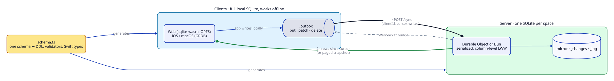

# sync-engine

An opinionated offline-first sync engine for small personal apps. Every client keeps a full SQLite copy of its data, reads and writes it with no network, and syncs rows with a tiny server when it can. It replaces PowerSync in our own apps.

## Guiding principles

- **Local first.** The app's database is the source of truth for the UI. Reads and writes never wait on the network.
- **The server is not a server.** One Cloudflare Durable Object per space, on the free tier, with nothing to provision. A new environment is one deploy; a local run starts in about a second with no cloud account.
- **Built for one or a few users.** Human-speed writes, thousands of rows, not millions. Simplicity wins over scale every time.
- **One schema, every runtime.** A single TypeScript file produces the SQLite DDL for client and server, the validators and the Swift types. No backwards compatibility: clients re-pull when the shape changes.
- **Rows on the wire, not actions.** Clients sync row writes, so the server runs no app logic and TypeScript and Swift never need matching reducers.
- **Few dependencies, proven protocol.** The core is plain TypeScript over a small SQL interface. The protocol is modeled and its laws proved in [Bend](spec/), and the core is tested against that model.

## The problem

Offline-first apps usually mean a hosted sync service, a managed Postgres, an always-on VM and a monthly bill, all sized for workloads a personal app never has. sync-engine keeps the good part (instant local UI, background sync, multi-device) and drops the rest.

## How it works

1. **Define** the tables once in `schema.ts`. `generate()` emits client and server DDL, zod validators and Swift types.
2. **Write locally.** The app writes to its own SQLite (sqlite-wasm on OPFS on the web, shared across tabs; GRDB on iOS and macOS). Triggers record each change in `_outbox` as a put, patch or delete.
3. **Sync in one round trip.** `POST /sync {clientId, cursor, writes}` sends the outbox. The server applies writes exactly once per client sequence and answers with every row changed since the cursor, or a paged snapshot for a new or long-offline client.
4. **Resolve conflicts simply.** Column-level last write to arrive wins, a delete beats a later patch, and a rejected write is dropped and restored on the next pull.
5. **Stay live.** A hibernating WebSocket nudges clients with the new cursor so other devices pull within milliseconds. Old tombstones and log rows compact behind a retention horizon.

## Packages

| Import                                 | What it is                                        |
| -------------------------------------- | ------------------------------------------------- |
| `sync-engine/schema`                   | Schema definition and code generation             |
| `sync-engine/core`                     | The protocol: space, apply, pull, compaction      |
| `sync-engine/client`                   | Runtime-agnostic sync client                      |
| `sync-engine/client-web`               | Browser client on sqlite-wasm + OPFS, multi-tab   |
| `sync-engine/cloudflare`               | Worker and Durable Object server                  |
| `sync-engine/bun-server`, `bun-sqlite` | Local server and driver for development and tests |
| `SyncEngine` (SwiftPM)                 | Swift client over GRDB                            |

## Learn more

- [Protocol](docs/protocol.md)
- [Decisions](docs/decisions/README.md): goals, sync model, stack, Swift client
- [Investigation](docs/investigation/README.md) that led here
